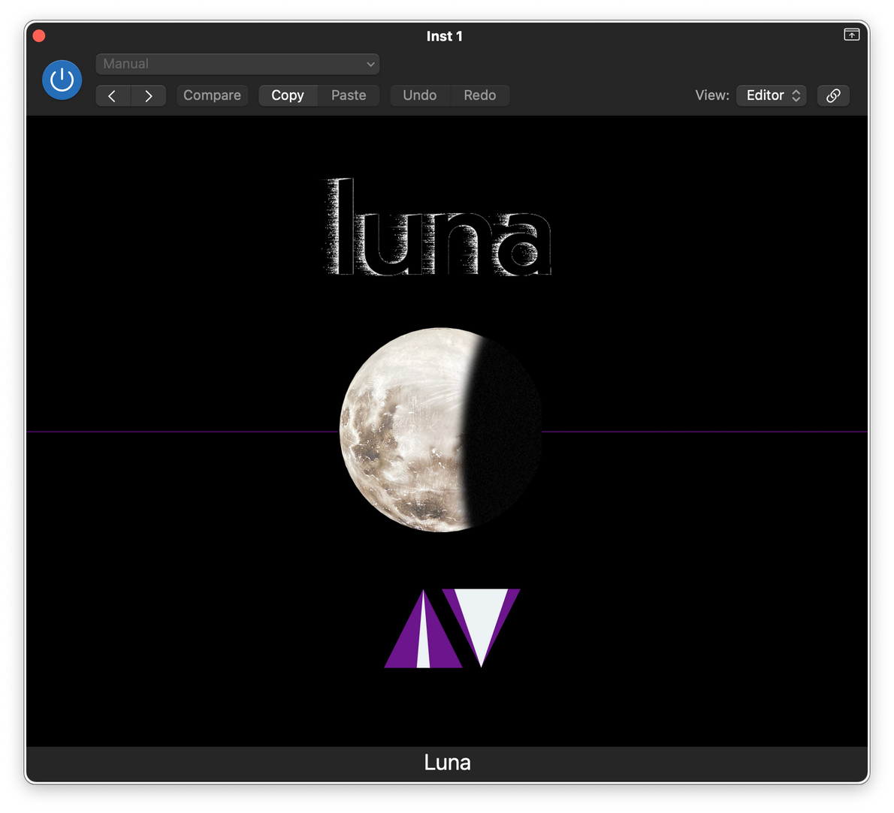

# Luna

A minimalistic distortion plug-in for modern music production. Colorful, harsh, asymmetric
saturation. Built in C++ with JUCE, shipping as VST3 and AU Component.

Senior design project at Drexel, built by a two-person team I led.



## What it does

Luna is a polarity-sensitive waveshaper. Instead of applying one transfer function to the whole
signal, it shapes the positive and negative halves of the waveform independently, with a
separate drive parameter for each:

```
            ⎧   √(  (1 + a²)·sin(x)   /  (1 + a²·sin²(x)) )     x > 0
    f(x) =  ⎨
            ⎩  −√( (1 + b²)·|sin(x)|  /  (1 + b²·sin²(x)) )     x < 0
```

Driving the two halves differently breaks the odd symmetry a conventional waveshaper has. That
asymmetry is what generates even-order harmonics, which is why this kind of clipping sits
closer to tube saturation than a symmetric digital clipper does. Set both drives equal and the
curve collapses back to symmetric, which is a useful A/B.

The shaped signal is then crossfaded against the dry path.

Works well on leads, subs and vocals.

## Controls

| Control | What it is | Maps to |
| --- | --- | --- |
| Left triangle | Drive for the positive half of the waveform | `a` |
| Right triangle | Drive for the negative half | `b` |
| Moon | Dry/wet mix | `dw` |

The interface is hand-built rather than assembled from JUCE defaults, with custom `LookAndFeel`
implementations for the moon and for the two triangular drive controls. The triangles point
opposite ways because they shape opposite halves of the wave.

## Install

Download the latest build from [Releases](../../releases).

**AU**

1. Drag `Luna.component` into `/Library/Audio/Plug-Ins/Components/`
2. Rescan plug-ins in your DAW
3. macOS will likely block it on first scan. Go to System Settings, then Privacy & Security,
   and click Allow at the bottom
4. Reopen your DAW

**VST3**

Same, into `/Library/Audio/Plug-Ins/VST3` on macOS or `C:\Program Files\Common Files\VST3`
on Windows.

## Building from source

Open `Luna/Luna.jucer` in Projucer, export to your IDE, and build. Requires JUCE 7 or later.

```
Luna/Source/
  PluginProcessor.{h,cpp}     DSP, parameter layout, processBlock
  PluginEditor.{h,cpp}        window layout, control wiring
  MoonSlider*.{h,cpp}         dry/wet control + LookAndFeel
  DistSliderA*, DistSliderB*  drive controls + LookAndFeel
Luna/Resources/               UI artwork
```

## Known issues

- **Dist A/B overlay.** The two drive controls overlap at some window sizes.
- **Rare sudden volume spikes.** Suspected cause: `dist_sample_value` is a processor member
  and is only assigned when the input sample is non-zero, so a sample of exactly zero reuses
  the previous value and still mixes it into the output. Declaring it inside the loop should
  fix it. A second candidate is that `sin(x)` turns negative for inputs above π, which makes
  the positive-half square root produce NaN on very hot signals.

## Limitations

- **The controls are not plug-in parameters.** `a`, `b` and `dw` are plain members on the
  processor, written directly from the editor, so they never pass through the
  `AudioProcessorValueTreeState`. No host automation, no session recall, and the message
  thread writes values the audio thread reads without synchronization. A `SliderAttachment`
  per control is the fix, and the first thing I would change.
- **The Gain parameter is inert.** It is registered in the parameter layout, but the code that
  applies it is commented out.
- **No oversampling.** Any waveshaper generates harmonics above Nyquist, which fold back as
  inharmonic aliasing. Oversampling the shaping stage 4x and filtering before decimation is the
  standard remedy.
- **Output is scaled by a fixed `0.3`** after shaping to avoid clipping at high drive, rather
  than normalizing against the transfer function's own gain.
- **The visualizer redraws inefficiently.** `MainComponent::update` calls `addNewSample`
  once per sample in the delay buffer, and each call does a `std::rotate` across the full
  1024-element history, so a 512-sample buffer moves over half a million elements per frame
  at 60 fps. A circular write index would make it O(1) per sample. It holds up on current
  hardware but scales badly with buffer size.

## License

See `LICENSE`.
